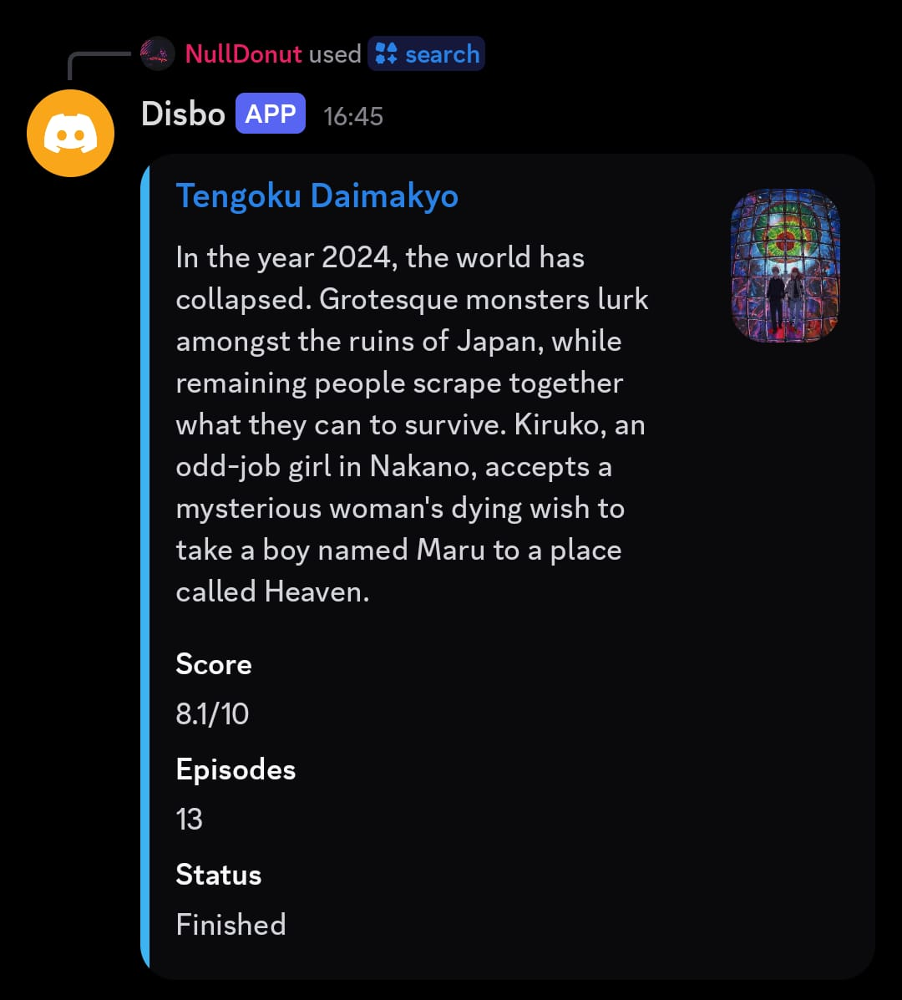
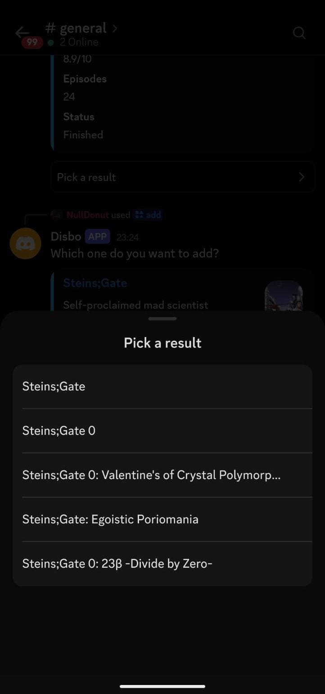
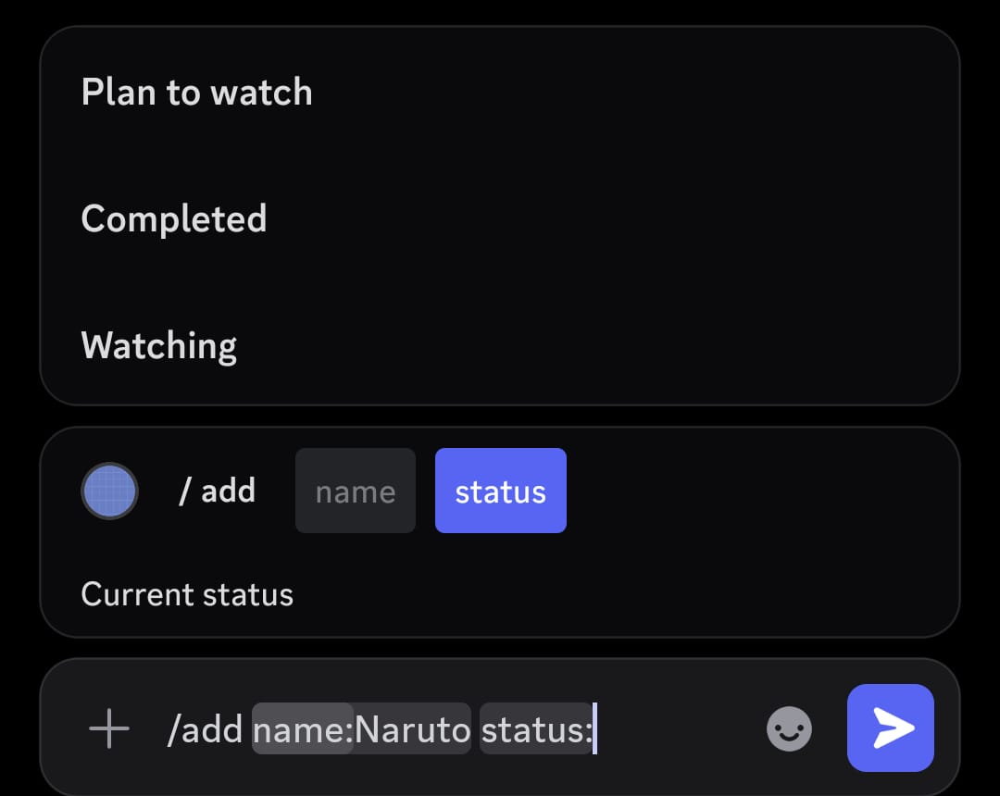
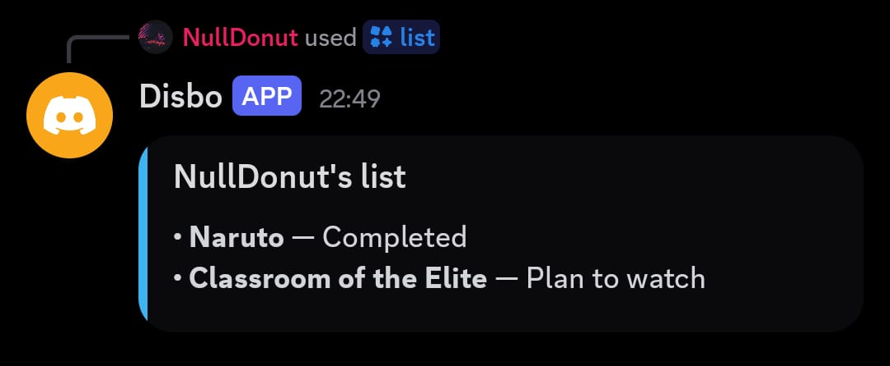

# Disbo
A discord bot to search anime and keep a personal watchlist, right in your server.


[Add disbo to your server](https://discord.com/oauth2/authorize?client_id=1560541350682689577&permissions=18432&integration_type=0&scope=bot)
[Try it in this demo server](https://discord.gg/4vqSBCafa)



## Commands
| Command | What it does |
|---------|--------------|
| '/search <title>' | Show cover,score,episodes,status and synopsis|
| '/add <title> <status>' | Saves a show as Plan to watch,Watching or completed|
| '/list' | Show your watchlist|
| '/remove <title>'| Removes a show from your list |

<p align="center">



</p>
## Permissions
Disbo asks for as little as possible:

- **Scopes:** `bot` and `applications.commands`
- **Bot permissions:** Send Messages,Embed Links
- **Intents:** none beyond the default.It does **not** read message content.

## Data Stored
Only your Discord user ID,the shows you add (Anilist ID and title) and their status,in a server side sqlite database.No messages stored whatsover

## Run your own copy
* Create a app at Discord developer portal and add a bot user.
* Clone this repository:
```
git clone https://github.com/nulldonut/disbo.git/
```
* Install Directory: 
```
pip install -r requirements.txt
```
* Create '.env' containing 
```
TOKEN=your_bot_token
```
* Run 'python main.py'
* Invite it with the OAuth2 URL (scopes 'bot' and 'application.commands').
* Only permissions the bot needs are "Send Messages" and "Allow Link Embeds"

## Basic info and overview

It uses discord.py as discord handler.It fetches content from anilist official graphql api.All personal watchlist are stored differently in a single sqlite database (server side).
It used async libraries (aiosqlite,aiohttp) for efficient and fast backend.
It is hosted on a public hacker lab (nest) instance ;)


## Roadmap
- Movies via TMDB
- `/rate` and scores in `/list`
- Paginated `/list`

## Credits
Anime data from anilist. Built for Hack Club Crescent.
